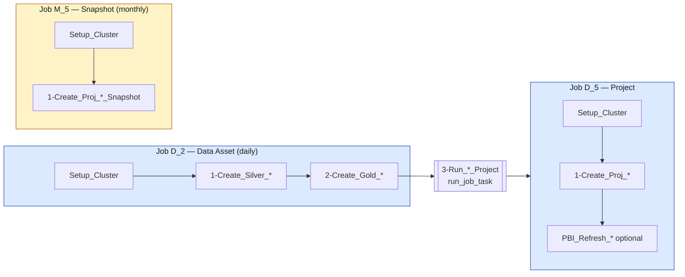

# Template — Databricks Asset Bundle for a data asset or a project job (LEAP CORE, classic cluster)

Template for a **data asset** (silver → gold) and/or a **project job** on a **classic (non-serverless) cluster**.
Copy this folder, rename it, replace the `<<< REPLACE >>>` markers, validate, deploy.

> For an **ingestion** (source → bronze), do not use this template: use the ingestion bundles (`F_0/F_1` file or `D_0/D_1` table).

---

## 1. Job naming convention

Job name = **`<FREQ>_<STAGE>_<Source>_<Name>_<Suffix>`**

| `FREQ` (letter) | Meaning | `STAGE` (number) | Level |
|---|---|---|---|
| **D** | **Daily** or a **table-update delta** trigger | **2** | data asset (silver/gold) |
| **W** | **Weekly** | **5** | project / snapshot |
| **M** | **Monthly** | *(0 / 1)* | *reserved for ingestion (job / pipeline)* |

> The letter `F` (file) and `D` in the "source table" sense are reserved for the **ingestion bundles**. For a data asset or a project, the letter is the **schedule frequency** (or `D` when the job is triggered by a `table_update`).

Examples produced by this template:

| File | Job | Trigger |
|---|---|---|
| `resources/data_asset_job.yml` | `D_2_SAP_Material_Master_Data_Asset` | daily 06:00 (or table-update) |
| `resources/project_job.yml` | `D_5_SAP_UC070_Material_Analysis_Project` | child of the data asset (`run_job_task`) |
| `resources/snapshot_job.yml` | `M_5_SAP_UC070_Material_Analysis_Snapshot` | monthly (1st of the month, 09:00) |

---

## 2. Flow



- Every job starts with `Setup_Cluster` (notebook `unity_catalog/Utils/Jobs/Setup cluster`, mandatory).
- All notebooks are read from **Git (Bitbucket Cloud)** at branch `${var.git_branch}`.
- The data asset chains the project job through `run_job_task` (delete that task if there is no project layer).

---

## 3. Bundle content

```
_template_data_asset/
├── databricks.yml                 # variables + 3 targets (dev/uat/prod), prod git.branch: main
├── resources/
│   ├── data_asset_job.yml         # D_2: Setup → Silver → Gold → [Run project]
│   ├── project_job.yml            # D_5: Setup → Proj → [refresh PBI]
│   ├── snapshot_job.yml           # M_5: monthly snapshot (optional)
│   ├── schemas_and_volumes.yml    # OPTIONAL: create a schema and/or a volume through the bundle
│   └── genie_space.yml            # OPTIONAL: deploy a Genie space (AI/BI agent)
└── README.md
```

### Variables provided (`databricks.yml`)

| Variable | Meaning |
|---|---|
| `git_branch` | Git branch of the notebooks (dev/uat = feature branch; **prod = `main`**) |
| `pipeline_read_env` / `pipeline_write_env` / `reference_read_env` | LEAP widgets (reference = `prod` in non-prod) |
| `dbx_service_principal` | Run-as service principal `job-runner-sa-{env}` |
| `job_cluster_policy_id_{XS,S,M,M_MULTI,L,L_MULTI,XL_MULTI}` | **CORE cluster policies** per size × env |
| `notification_email` | Recipient of failure alerts (**prod = `LEAP_Databricks_Alert`**) |
| `pbi_workspace_id` / `pbi_semantic_model_id` | PowerBI refresh (optional, `"0"` when unused) |

### Schema and volume created by the bundle (optional)

`resources/schemas_and_volumes.yml` creates a **schema** and/or a **volume** at `bundle deploy` (for example a `proj` schema, or a MANAGED or EXTERNAL export volume), with their grants — modelled on `sps_rfq_ingestion`. Catalogs resolve per target through `my_gold_catalog` / `my_proj_catalog` (`{env}_gold` / `{env}_proj`). **Delete this file and these variables if unused.**

### Genie space deployed by the bundle (optional)

`resources/genie_space.yml` (commented by default) promotes a Genie space (agent) dev → uat → prod through the native `genie_spaces` resource. The definition is not written by hand: edit it in the UI, then bring it back with `databricks bundle generate genie-space --existing-id <id> --key <key> -t dev --profile DEV`, which produces the YAML and a `src/<key>.geniespace.json`. Then parameterize `genie_warehouse_id` per env, with `parent_path = ${workspace.root_path}` (the bundle folder, never `/Workspace/Shared`). Full reference: `platform/asset_bundle/site_performance_genie`.

### Cluster sizes

Choose the size by changing the `policy_id` variable of the `job_cluster`:
`XS` / `S` / `M` / `L` = **single-node** (no `autoscale`) · `*_MULTI` = **multi-node** (add the `autoscale` block).
The tag `activity-type: ${var.pipeline_write_env}-job` is **required by the policy** and already set.

---

## 4. Step by step

1. **Copy** the folder and rename it (bundle name, e.g. `material_master`).
2. In `databricks.yml`: `bundle.name`, `git_branch` (dev/uat), `notification_email` (dev/uat), `pbi_*` (prod if needed).
3. In `resources/*.yml`: replace every `<<< REPLACE >>>` (resource keys, job names following the convention, `notebook_path`, domain tags). Delete `snapshot_job.yml` and/or the `3-Run_*_Project` task if unused.
4. **Validate**:
   ```bash
   databricks bundle validate -t dev --profile DEV
   ```
5. **Deploy and run on dev, as yourself** (personal profile):
   ```bash
   databricks bundle deploy -t dev --profile DEV
   databricks bundle run data_asset -t dev --profile DEV
   ```
6. **Deploy to dev / uat / prod, as the job runner** (service principal, through CI): go to **Bitbucket → Pipelines**, run the manual pipeline for the environment from the wanted branch (or `main` for prod), with the **bundle name**:

   | Environment | Bitbucket manual pipeline | Branch |
   |---|---|---|
   | dev | `deploy-leap-dev-bundles` | your feature branch |
   | uat | `deploy-leap-uat-bundles` | your feature branch |
   | prod | `deploy-leap-prod-bundles` | `main` (merged branch) |

---

## 5. Points of attention

- **Policy tag**: never remove `activity-type: ${var.pipeline_write_env}-job` from the cluster; the policy rejects the cluster without it.
- **`run_job_task.job_id`**: `${resources.jobs.<resource_key>.id}` must point at the resource key of the project job.
- **Table-update trigger**: at most **10 tables** per trigger.
- **prod = `main`**: the prod target always deploys from `main` (`targets.prod.git.branch: main`).
